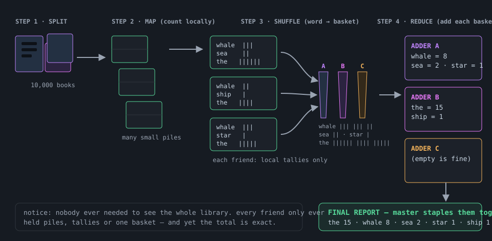
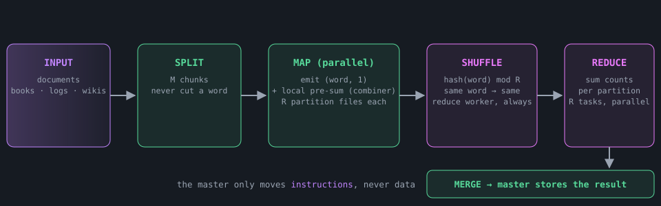
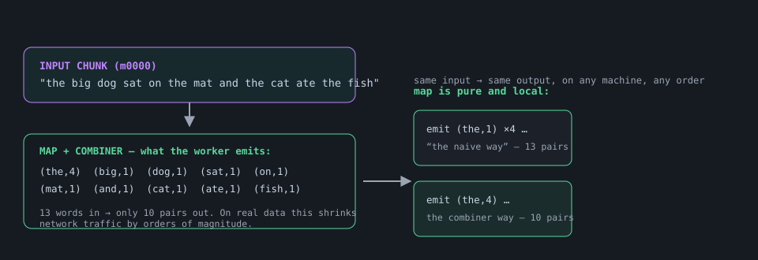
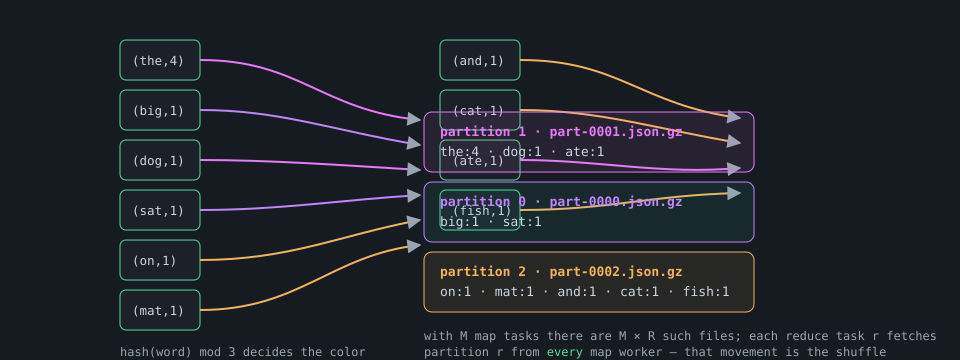
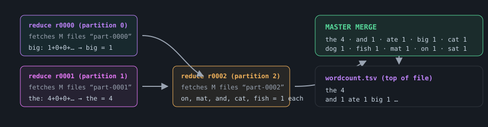
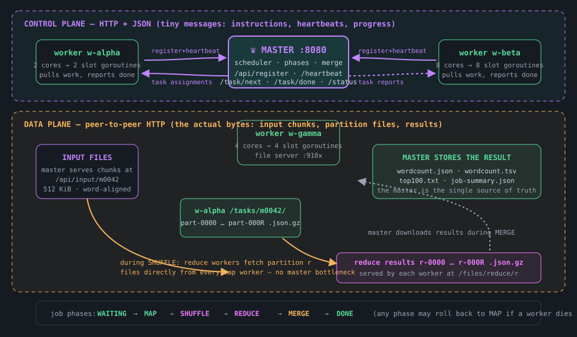
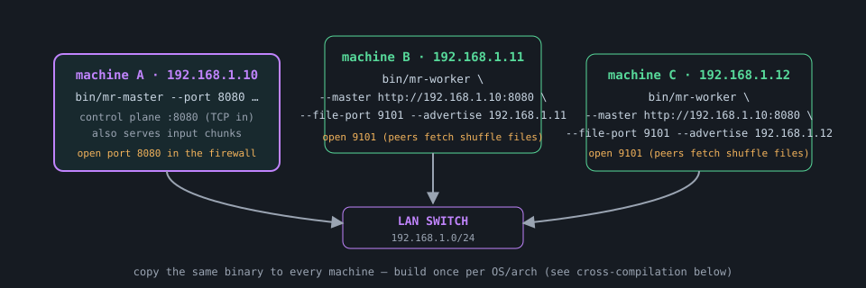

# CuteyMR — MapReduce WordCount, Explained From Zero

*the illustrated guide · pure go · zero dependencies*

How one master and a swarm of workers count every word in a pile of documents — told with pictures, and real code you can run tonight.

`go 1.21+` · `stdlib only` · `HTTP + JSON` · `peer-to-peer shuffle` · `terminal dashboards` · `fault tolerant`


*CuteyMR in one picture: cut the books up (split), let every person count words (map), send the word cards to the right bin (shuffle), and add each bin up (reduce).*

## What’s inside

1. [Counting words with friends (a story)](#1--counting-words-with-friends--a-story)
2. [What MapReduce actually is](#2--what-mapreduce-actually-is)
3. [WordCount, step by step](#3--wordcount-step-by-step)
4. [Inside CuteyMR: the architecture](#4--inside-cuteymr--the-architecture)
5. [The wire protocol](#5--the-wire-protocol)
6. [When workers die](#6--when-workers-die)
7. [The terminal dashboards](#7--the-terminal-dashboards)
8. [A walk through the code](#8--a-walk-through-the-code)
9. [Compile & run it](#9--compile--run-it)
10. [Running on real machines](#10--running-on-real-machines)
11. [How it was tested](#11--how-it-was-tested)
12. [Glossary & FAQ](#12--glossary--faq)

## 1 · Counting words with friends — a story

Before any diagrams or code, imagine this. You manage a small library, and one morning the head librarian asks you a deceptively simple question:

> **STORY: the librarian’s question**
>
> “In all **10,000 books** of this library — which words appear most often, and exactly how many times does each word appear?”

You look at the mountain of books and think: *reading every book myself would take a year.* But you have friends — lots of friends — and a big table. So you invent a plan on the spot:

**Step 1 — Tear the problem into pieces.** You don’t hand out whole books; you rip each book into **page-piles** (never tearing a page in half — words must stay whole). One pile per friend is too few; you make many small piles so nobody waits with an empty table.

**Step 2 — Everyone counts locally.** Each friend takes a pile and makes a **tally sheet**: every time they see the word “whale”, they add a stroke next to `whale`. “whale, whale, whale…” becomes `whale |||`. They do NOT try to know the library-wide answer — only their pile’s. That is the magic trick: *small, independent, no-talking-needed work.*

**Step 3 — Send tallies to the right person.** Now you need the library-wide total. You put **three baskets** on the table, labeled A, B and C. There’s a silly-but-reliable rule for where each word goes: you count the letters of the word, and if the count divides evenly by 3 it goes in basket A, if it leaves remainder 1 it goes in B, remainder 2 in C. Every friend sorts their tallied words into the baskets. Crucially, *the same word always lands in the same basket* — all “whale” tallies end up together, whoever counted them.

**Step 4 — Basket owners add up.** Three more friends each grab one basket and simply **add**: whale from pile 1 was 3, pile 7 was 5, pile 12 was 2 → whale = 10. Because baskets never mix words, each adder works alone, in parallel, and can never disagree.

**Step 5 — You collect the three results.** You staple the three basket totals into one final report and hand it to the librarian. Done before lunch.



*The library plan. Steps 1–2 are the **Map** half; step 3 is the **Shuffle**; steps 4–5 are the **Reduce** half.*


*One master (the person with the clipboard) and many workers — the whole system in one cozy picture.*

> **NOTE: why this plan is brilliant**
>
> Three properties make it scale to millions of books: **(1)** friends never talk to each other while counting — no arguments, no waiting; **(2)** if a friend falls asleep, you just give their pile to someone else and nothing is lost; **(3)** adding friends linearly adds speed. MapReduce is exactly this plan, executed by computers.

## 2 · What MapReduce actually is

MapReduce is a programming model from a famous 2004 Google paper (“*MapReduce: Simplified Data Processing on Large Clusters*”, Dean & Ghemawat). The library story you just read **is** the model. Here is the same plan with the proper vocabulary:

| story | MapReduce term | what it really means |
| --- | --- | --- |
| page pile | **input split / chunk** | a slice of the input data, small enough for one machine to chew quickly |
| friend + tally sheet | **map task** | a program that reads one chunk and *emits key/value pairs*. For wordcount: every word emits `(word, 1)` |
| letter-count rule | **partitioning function** | a hash like `hash(word) mod R` that picks a basket — the same key always lands in the same basket, on every machine, forever |
| baskets + sorting | **shuffle** | the phase where all pairs with the same key travel to the one reducer that owns that key’s basket |
| adder friend | **reduce task** | a program that receives all pairs of one partition and combines them — for wordcount: *sum the counts* |
| you, the planner | **master** | tracks who is alive, hands out tasks, watches progress, never touches the data itself |

So a MapReduce **job** is just two tiny functions you write…

```text
map(document_chunk):        reduce(key, values):
    for word in words(chunk)     return key, sum(values)
        emit(word, 1)
```

…and everything else — splitting, distributing, shuffling, retrying when machines die, merging, writing the final output — is the framework’s job. That division of labor is why “mere mortals” could suddenly write distributed programs in three lines.



*The full pipeline. Data flows left to right; the green boxes run on many machines at once.*

> **NOTE: why “wordcount” is the hello-world of mapreduce**
>
> Word counting is the perfect first example because (a) it is instantly understandable, (b) map and reduce are each three lines long, and yet (c) it exercises the *entire* machinery — splits, parallel maps, hash partitioning, a real shuffle over the network, parallel reduces and a final merge. If your cluster counts words correctly, it can do anything MapReduce can.

## 3 · WordCount, step by step

Let’s push one tiny sentence through the whole machine and watch every number. Our input document is:

```text
"the big dog sat on the mat and the cat ate the fish"
```

It contains `13 words` (with repeats) and `10 unique words`. Suppose the cluster chose `R = 3` partitions, and the partitioner is FNV-1a — the exact hash CuteyMR uses. Here are the real values it computes:

| word | fnv32a(word) | mod 3 → basket |
| --- | --- | --- |
| the | `3020861980` | `1` |
| big | `…` | `0` |
| dog | `…` | `1` |
| sat | `3592196823` | `0` |
| on | `1630810064` | `2` |
| mat | `3819107837` | `2` |
| and | `…` | `2` |
| cat | `108289031` | `2` |
| ate | `476152855` | `1` |
| fish | `2947385699` | `2` |

**Map.** A map worker reads the sentence and emits one pair per word — then (this is CuteyMR’s built-in *combiner*) pre-sums repeats locally so only 10 tiny pairs leave the machine:



*Map phase for our sentence. The combiner is an optional local pre-reduction — for word counting it is exactly the reduce function, applied early.*

**Shuffle.** The worker writes each pair into one of R=3 partition files following the hash rule, and other workers fetch those files peer-to-peer when the reduce phase starts:



*The shuffle: pairs are routed by hash so every occurrence of a word meets every other occurrence, in exactly one place.*

**Reduce.** Each reduce worker owns one partition. It fetches that partition’s file from *every* map worker (peer-to-peer HTTP in CuteyMR), merges and sums them, and stores its partial result:



*Reduce + final merge. Partitions are disjoint by construction, so the master’s merge is a trivial concatenation — no conflicts are even possible.*

> **NOTE: the correctness argument, in one breath**
>
> No word is ever lost because chunks never split words; no word is ever double-counted because chunks are disjoint; and every occurrence of a word meets every other occurrence exactly once because `hash(word) mod R` routes deterministically to one reducer. Parallelism never has to argue with correctness — the hash function already agreed on everything beforehand.

## 4 · Inside CuteyMR — the architecture

CuteyMR implements the story faithfully with three kinds of participants: **one master** (the planner), **N workers** (the friends), and **two separate networks** — a control plane where instructions flow, and a data plane where the actual words travel peer-to-peer.



*CuteyMR’s two planes. Purple = control (tiny JSON messages), amber = data (files, peer-to-peer). The master schedules everything but never becomes a data bottleneck.*

### One process, two roles, all cores

Each `mr-worker` process creates **one goroutine per CPU core** — a *slot*. A slot is a simple loop: *ask the master for work → do it → report → repeat.* During the map phase slots run map tasks; during the reduce phase the very same slots run reduce tasks. Nothing is pre-assigned: whichever worker asks first gets the next idle task, so machines with more cores naturally take more work (they simply ask more often).

> **NOTE: why a pull model (workers ask) instead of push (master assigns)?**
>
> A worker knows exactly when its slot is free — the master can only guess. Pull-based scheduling makes load balancing automatic: fast machines ask more, get more. The 2004 Google paper uses the same trick (idle workers ask for tasks), and so does Hadoop.

### Life of a job, in order

1. **Boot.** The master starts and waits. Workers register, announcing their `cores`, `RAM`, hostname and the address of their own little file server. The dashboard already draws them — with dashed “ghost” cards for workers that haven’t arrived yet.
2. **Auto-start.** The moment the target number of workers is connected, the master splits every input document into word-aligned chunks (~512 KiB by default), creates `M` map tasks and `R` reduce tasks (R defaults to 2×workers, min 4) and enters the **MAP** phase.
3. **Map.** Slots pull map tasks, download their chunk from the master, tokenize, combine locally, and write R gzipped JSON partition files. The partition files are *stayed* on the worker that produced them — that’s the peer-to-peer data plane.
4. **Shuffle.** When the last map task finishes, the master builds each reduce task’s shopping list (which worker holds which file) and hands reduce tasks out. Reducers start pulling files from their peers — the network does the sorting.
5. **Reduce.** Each reducer sums its partition and stores `r-000r.json.gz`, then tells the master where to find it.
6. **Merge.** The master downloads all R results, merges them (they’re disjoint by hash — no conflicts possible), sorts by count, and writes `wordcount.json`, `wordcount.tsv`, `top100.txt` and `job-summary.json` into the output directory.
7. **After the job.** Workers are daemons: when they next ask for work they receive a `shutdown` assignment — and simply idle, keeping their dashboards and file servers up. They stay online *forever* (just like the master) until you press `Ctrl+C`; each one then prints its personal summary and bows out with a smile `(^_^)/`. If you restart the master with a fresh job, idle workers re-register automatically and get back to work.

## 5 · The wire protocol

Plain HTTP + JSON over TCP — deliberately boring so you can debug the whole cluster with `curl`. Every message fits on one screen.

| direction | endpoint | purpose | key fields |
| --- | --- | --- | --- |
| worker → master | `POST /api/register` | join the cluster, announce resources & file-server address | `worker_id, host, file_port, cores, memory_mb` |
| worker → master | `POST /api/heartbeat` `1/s` | “I’m alive” + live stats for the dashboards | `active[] {task, progress, fetch 4/12…}, words, bytes` |
| worker → master | `GET /api/task/next?worker=…` | pull the next task (or `none` / `shutdown`) | map: `input_url, num_partitions` · reduce: `sources[]` |
| worker → master | `POST /api/task/done` | report success (stats + where files live) or failure | `stats, partition_sizes[] · result_url · failed_source` |
| master → worker | `GET /api/input/{task}` | serve one word-aligned input chunk | raw text bytes |
| worker → worker | `GET /files/map/{task}/{r}` | **the shuffle**: fetch one intermediate partition file from a peer | gzip JSON `{word: count}` |
| worker → master | `GET /files/reduce/{r}` | master downloads one final reduce result during MERGE | gzip JSON `{word: count}` |
| anyone | `GET /api/status` | full JSON snapshot of the cluster (used by tests) | job, workers, all tasks, event log |

> **NOTE: why http and not websockets?**
>
> HTTP/JSON keeps every message stateless, retryable and inspectable — you can literally watch the shuffle happen with `tail -f` and replay any request with `curl`. For a batch workload that polls every few hundred milliseconds, WebSockets would add complexity (connection state, reconnect logic, frame parsing) without adding capability. The heartbeat poll doubles as liveness detection for free.

## 6 · When workers die

Machines crash, networks blip, someone trips over a cable. CuteyMR treats all of it as a scheduling problem, not a catastrophe. Three mechanisms cooperate:

| mechanism | detects | recovers |
| --- | --- | --- |
| **heartbeat timeout** (`10 s, checked every second`) | a worker that went silent entirely | master re-queues every task that worker held — including *completed* map tasks whose intermediate files died with it |
| **data-plane probe** (`on fetch failure`) | a reduce task that cannot fetch a peer’s file | master actively pings that peer’s file server; if it is dead, the worker is marked dead *immediately* — no waiting for the 10-second timeout while retries burn |
| **MAP rollback** | a dead worker whose partition files are still needed | the job rolls back to the MAP phase, the affected chunks are re-processed on healthy machines, and the shuffle is rebuilt — reduce tasks that already finished keep their results |

Every task tolerates `3 failures`; only then does the job declare FAILURE (a “poison” task would otherwise loop forever). Reports are idempotent — if a “task done” message gets lost and re-sent, the master simply ignores the duplicate. And because map and reduce are *pure functions*, re-running a task on a different machine always yields the identical answer; that single property is what makes all of this recovery possible at all.

> **WARNING: tested with fire**
>
> The test suite literally executes `kill -9` on a worker mid-job — once during the map phase and once during the shuffle — and then verifies the final wordcount *byte-for-byte* against a sequential reference run. Both scenarios end in **PASS**. Section 11 shows the transcripts.

## 7 · The terminal dashboards

Every process — master and each worker — renders its own live dashboard, repainting the terminal ~4 times a second with pure ANSI escapes (no dashboard library, no dependency). The master’s centerpiece is the **cluster topology**: the master box, a network “bus”, and one card per worker with a face that reflects its mood.

| face | meaning |
| --- | --- |
| `(-.-)z` | connected, waiting for the job to start (asleep) |
| `(>_<)` | mapping hard |
| `(^_-)` | reducing (winking — almost done) |
| `(>o<)` | doing both map and reduce at once |
| `(o_o)` | idle, watching |
| `(^▽^)` | job finished, happy |
| `(x_x)` | unreachable / dead |
| `(? ?)` | ghost card — the master is still waiting for this worker to connect |

Here are three **real frames** captured from a live run (ANSI colors flattened for print — on a terminal the bars are green/pink/amber and the packet dots animate along the wires):

### Waiting for the swarm

```console
 ● CUTEYMR  MASTER                                                              WAITING · workers 1/3 · 00:00
──────────────────────────────────────────────────────────────────────────────────────────────────────────────

 ⠋ waiting for workers 1/3 — job auto-starts when all 3 connect

┌─ CLUSTER TOPOLOGY — 1/3 online ────────────────────────────────────────────────────────────────────────────┐
│                                   ┌────────────────────────────────────┐                                   │
│                                   │         ♛ CUTEYMR  MASTER          │                                   │
│                                   │         listening on :8083         │                                   │
│                                   │              WAITING               │                                   │
│                                   │             0 words/s              │                                   │
│                                   └────────────────────────────────────┘                                   │
│                                                      │                                                     │
│                                                      │                                                     │
│                      ─────────────────────────────────────────────────────────────────                     │
│                      │                               │                               │                     │
│       ┌────────────────────────────┐  ┌────────────────────────────┐  ┌────────────────────────────┐       │
│       │ (-.-)zw-calm-jackal-4f08   │  │                            │  │                            │       │
│       │ 127.0.0.1:9312             │  │                            │  │                            │       │
│       │ cpu ░░░░░░░░░░ 0/2         │  │                            │  │           (? ?)            │       │
│       │ done 0 · 0 words           │  │      awaiting worker…      │  │      awaiting worker…      │       │
│       │ ready                      │  │                            │  │                            │       │
│       └────────────────────────────┘  └────────────────────────────┘  └────────────────────────────┘       │
└────────────────────────────────────────────────────────────────────────────────────────────────────────────┘
┌─ WORKERS ──────────────────────────────────────────────────────────────────────────────────────────────────┐
│WORKER                HOST                CORES  MEM      STATE    DONE   WORDS      RATE                   │
│────────────────────────────────────────────────────────────────────────────────────────────────────────────│
│w-calm-jackal-4f08    127.0.0.1:9312       2      4.06GB   alive    0      0           0/s                  │
└────────────────────────────────────────────────────────────────────────────────────────────────────────────┘
```

The first person is asleep at their desk `(-.-)z`; the two ghost cards are the master saying “two seats still open”. The ⠋ spinner and the elapsed clock tick live.

### Mid-map, everyone sweating

```console
 ● CUTEYMR  MASTER  · wordcount job                                                 MAP · workers 3/3 · 00:01
──────────────────────────────────────────────────────────────────────────────────────────────────────────────

 MAP     ███████████████████████████░░░░░░░░░░░░░░░░░░░░░░░░░░░░   49%  61/124 tasks  00:01
 SHUFFLE ░░░░░░░░░░░░░░░░░░░░░░░░░░░░░░░░░░░░░░░░░░░░░░░░░░░░░░░    0%  0/0 files  0B / 105.1kB
 REDUCE  ░░░░░░░░░░░░░░░░░░░░░░░░░░░░░░░░░░░░░░░░░░░░░░░░░░░░░░░    0%  0/12 tasks  00:00
 rate 0 w/s · counted 3.32M words · input 29.6MB · intermediate 105.1kB · uptime 00:02

┌─ CLUSTER TOPOLOGY — 3/3 online ────────────────────────────────────────────────────────────────────────────┐
│                                   ┌────────────────────────────────────┐                                   │
│                                   │         ♛ CUTEYMR  MASTER          │                                   │
│                                   │         listening on :8083         │                                   │
│                                   │          phase MAP 49%             │                                   │
│                                   │             0 words/s              │                                   │
│                                   └────────────────────────────────────┘                                   │
│                                                      │                                                     │
│                                                      │                                                     │
│                      ─────────────────────────────────────────────────────────────────                     │
│                      O                               o                               ∙                     │
│       ┌────────────────────────────┐  ┌────────────────────────────┐  ┌────────────────────────────┐       │
│       │ (>_<) w-zesty-ibex-a444    │  │ (>_<) w-happy-marmot-9654  │  │ (>_<) w-cosmic-panda-e82e  │       │
│       │ 127.0.0.1:9312             │  │ 127.0.0.1:9313             │  │ 127.0.0.1:9311             │       │
│       │ cpu ██████████ 2/2         │  │ cpu ██████████ 2/2         │  │ cpu █████░░░░░ 1/2         │       │
│       │ done 19 · 1.03M words      │  │ done 21 · 1.17M words      │  │ done 21 · 1.13M words      │       │
│       │ mapping×2                  │  │ mapping×2                  │  │ mapping×1                  │       │
│       └────────────────────────────┘  └────────────────────────────┘  └────────────────────────────┘       │
└────────────────────────────────────────────────────────────────────────────────────────────────────────────┘
```

All three workers show their `(>_<)` “concentrating” face, CPU bars are full, and the little `O o ∙` glyphs on the wires are **packets** — they animate up and down the drops while work flows (during the shuffle phase the horizontal bus itself gets moving dots, like a busy Ethernet segment).

### Done — with the results built in

```console
 ● CUTEYMR  MASTER  · wordcount job                                                DONE · workers 3/3 · 00:07

 MAP     ███████████████████████████████████████████████████  100%  124/124 tasks  00:01
 SHUFFLE ███████████████████████████████████████████████████  100%  1488/1488 files  211.7kB / 211.7kB
 REDUCE  ███████████████████████████████████████████████████  100%  12/12 tasks  00:00
 rate 4.14M w/s · counted 6.56M words · input 29.6MB · intermediate 211.7kB · uptime 00:02

┌─ CLUSTER TOPOLOGY — 3/3 online ────────────────────────────────────────────────────────────────────────────┐
│                                   ┌────────────────────────────────────┐                                   │
│                                   │         ♛ CUTEYMR  MASTER          │                                   │
│                                   │             DONE 100%              │                                   │
│                                   └────────────────────────────────────┘                                   │
│       ┌────────────────────────────┐  ┌────────────────────────────┐  ┌────────────────────────────┐       │
│       │ (^▽^) w-merry-tiger-e9d1   │  │ (^▽^) w-proud-raven-7d10   │  │ (^▽^) w-sunny-cobra-53e7   │       │
│       │ finished                   │  │ finished                   │  │ finished                   │       │
│       └────────────────────────────┘  └────────────────────────────┘  └────────────────────────────┘       │
└────────────────────────────────────────────────────────────────────────────────────────────────────────────┘
┌─ WORKERS ──────────────────────────────────────────────────────────────────────────────────────────────────┐
│w-merry-tiger-e9d1    127.0.0.1:9313       2      4.06GB   alive    33     1.81M       0/s                  │
│w-proud-raven-7d10    127.0.0.1:9312       2      4.06GB   alive    30     1.66M       0/s                  │
│w-sunny-cobra-53e7    127.0.0.1:9311       2      4.06GB   alive    71     3.10M       0/s                  │
└────────────────────────────────────────────────────────────────────────────────────────────────────────────┘
┌─ RESULTS — TOP WORDS ──────────────────────────────────────────────────────────────────────────────────────┐
│the                 835.4k ████████████████████████████████████████████████████████████████████████         │
│of                  418.6k ███████████████████████████████████████░░░░░░░░░░░░░░░░░░░░░░░░░░░░░░░░░         │
│and                 279.0k █████████████████████░░░░░░░░░░░░░░░░░░░░░░░░░░░░░░░░░░░░░░░░░░░░░░░░░░░         │
│to                  208.6k ███████████████████░░░░░░░░░░░░░░░░░░░░░░░░░░░░░░░░░░░░░░░░░░░░░░░░░░░░░░         │
│a                   167.8k ████████████████░░░░░░░░░░░░░░░░░░░░░░░░░░░░░░░░░░░░░░░░░░░░░░░░░░░░░░░░░░         │
└────────────────────────────────────────────────────────────────────────────────────────────────────────────┘
```

The final screen stays up (until `Ctrl+C`) so you can admire the top words, each worker’s share, and the whole event log. Meanwhile each **worker’s own dashboard** shows its slots working — one line per CPU core:

```console
 ● CUTEYMR  WORKER  w-lucky-tiger-4539 (>_<)                                       MAP · cluster 3/3 · 00:01
──────────────────────────────────────────────────────────────────────────────────────────────────────────────
┌─ TASK SLOTS — 2 cores, one goroutine each ─────────────────────────────────────────────────────────────────┐
│slot  type     task     stage          progress                                    words      rate          │
│────────────────────────────────────────────────────────────────────────────────────────────────────────────│
│s0    map      m0047    scan 62%       ████████████████░░░░  62%                  55.7k    0/s             │
│s1    map      m0051    fetch input    ██████░░░░░░░░░░░░░░  31%                  21.3k    0/s             │
└────────────────────────────────────────────────────────────────────────────────────────────────────────────┘
┌─ THIS WORKER ──────────────────────────────────────────────────────────────────────────────────────────────┐
│tasks 18  (map 18 · reduce 0)   words counted 954.2k   pairs merged 0                                       │
│read 4.3MB   wrote 31.9kB   errors 0   uptime 00:01                                                         │
└────────────────────────────────────────────────────────────────────────────────────────────────────────────┘
┌─ CLUSTER ──────────────────────────────────────────────────────────────────────────────────────────────────┐
│phase MAP   workers 3/3   cluster rate 1.65M w/s                                                             │
│my share of counted words: 62.1%  (954.2k of 1.54M)                                                         │
└────────────────────────────────────────────────────────────────────────────────────────────────────────────┘
```

## 8 · A walk through the code

The whole system is ~2,900 lines of Go in four internal packages plus four commands — small enough to read in an evening, structured so each concern has exactly one home.

```text
cuteymr/
├── cmd/                      one small main() per binary
│   ├── master/    main.go   flags → master.New(cfg) → Start → dashboard → wait
│   ├── worker/    main.go   flags → worker.New(cfg) → file server → register → Run()
│   ├── mockgen/   main.go   deterministic mock books (zipf-ish word mix)
│   └── wcseq/     main.go   sequential reference + verifier (--check)
├── internal/common/           shared by master & workers
│   ├── types.go       every wire message struct (one screen of JSON tags)
│   ├── http.go        JSON helpers + retrying client (GetJSON/PostJSON/GetBytes)
│   ├── tokenize.go     THE word definition + FNV-1a + PartitionOf + humanize
│   ├── jsonio.go       gzip+JSON file codec for all intermediate data
│   └── eventlog.go     ring buffer of timestamped events (feeds dashboards)
├── internal/termui/          dependency-free terminal canvas
│   ├── canvas.go       Cell grid → ANSI string; boxes, bars, sparklines
│   └── term_linux.go   TIOCGWINSZ ioctl for real terminal size
├── internal/master/
│   ├── state.go        all cluster state behind ONE mutex
│   ├── scheduler.go    job lifecycle: split → assign → transitions → recovery
│   ├── server.go       HTTP endpoints + worker monitor + data-plane probe
│   ├── merge.go        download R results, merge, write output files
│   └── dashboard.go    the animated master dashboard
├── internal/worker/
│   ├── worker.go       slots, heartbeats, registration, lifecycle
│   ├── tasks.go        executeMap / executeReduce with live progress
│   ├── files.go        peer-to-peer file server (path-traversal safe)
│   └── dashboard.go    the worker dashboard
├── scripts/  run_demo.sh · test_fault_tolerance.sh · verify.sh
├── data/input/  mock documents   data/output/  final results land here
└── Makefile · README.md · this guide
```

### The single source of truth for “what is a word”

Everything — mappers, combiner, and the sequential verifier — shares one tokenizer, which is what makes bit-exact verification possible. A word is a maximal run of `[a-z0-9'-]` in the lowercased text, and lone punctuation is skipped:

```go
// internal/common/tokenize.go
func TokenizeStream(text string, emit func(word string, endPos int)) {
    low := strings.ToLower(text)
    n := len(low)
    i := 0
    for i < n {
        for i < n && !isWordByte(low[i]) { i++ }   // skip separators
        if i >= n { break }
        j := i + 1
        for j < n && isWordByte(low[j]) { j++ }     // consume the word
        word := low[i:j]
        if hasAlnum(word) { emit(word, j) }           // "…" or "-" alone: not a word
        i = j
    }
}
```

### Splitting without cutting words in half

The master cuts documents into ~512 KiB chunks, but the cut point always slides forward to the next whitespace. Two adjacent chunks therefore never share or destroy a word:

```go
// internal/master/scheduler.go
func splitFileChunks(path string, chunkSize int64) []Chunk {
    data, _ := os.ReadFile(path)
    n := int64(len(data))
    var chunks []Chunk
    var start int64
    for start < n {
        end := start + chunkSize
        if end >= n {
            end = n
        } else {
            // never split inside a word: advance to the next whitespace
            for end < n && !isSpaceByte(data[end]) { end++ }
        }
        chunks = append(chunks, Chunk{File: path, Offset: start, Length: end - start})
        start = end
    }
    return chunks
}
```

### Map: count, combine, partition — all local

One map task is a pure function from bytes to R files. Notice there is no locking, no cluster awareness, nothing distributed in here — the difficulty of distribution lives elsewhere, which is exactly the point of MapReduce:

```go
// internal/worker/tasks.go (executeMap, slightly trimmed)
counts := make(map[string]int64, 1<<14)          // the combiner's tally sheet
common.TokenizeStream(string(input), func(word string, endPos int) {
    counts[word]++
    if endPos-lastPos >= 32768 {                   // live progress for the dashboards
        w.updateSlotProgress(idx, float64(endPos)/float64(total), tokens, "scan …")
    }
})
parts := make([]map[string]int64, R)              // R hash-partitioned mini tallies
for word, c := range counts {
    p := common.PartitionOf(word, R)              // fnv32a(word) % R
    if parts[p] == nil { parts[p] = make(map[string]int64) }
    parts[p][word] += c
}
for p := 0; p < R; p++ {                          // one gzipped JSON file per partition
    sizes[p], _ = common.WriteGzJSON(w.mapFilePath(a.TaskID, p), parts[p])
}
```

### The scheduler: one mutex, no cleverness

The master’s entire cluster state — workers, tasks, phases, progress — sits behind a single `sync.Mutex`. Handlers are tiny, transitions are plain functions called at well-defined moments, and the lock is never held across I/O. For a system of this scale that beats any lock-free wizardry: it is trivially correct to reason about, and the race-detector agrees (the test suite runs with `-race`):

```go
// internal/master/scheduler.go (NextTask — the entire scheduling hot path)
func (m *Master) NextTask(workerID string) common.TaskAssignment {
    m.mu.Lock()
    defer m.mu.Unlock()
    if _, ok := m.workers[workerID]; !ok { return …none }
    if m.job == nil { return …none }
    switch m.job.Phase {
    case common.PhaseMap:                          // hand out the next idle chunk
        for _, t := range m.mapTasks {
            if t.State == common.TaskIdle { return m.assignMapLocked(t, workerID) }
        }
    case common.PhaseShuffle, common.PhaseReduce:  // hand out the next partition
        for _, t := range m.reduceTasks {
            if t.State == common.TaskIdle { return m.assignReduceLocked(t, workerID) }
        }
    case common.PhaseDone, common.PhaseFailed:
        return …shutdown                           // polite: job over — workers idle until Ctrl+C
    }
    return …none
}
```

### Shuffling without a bottleneck

When the last map finishes, the master assembles each reduce task’s source list — the workers’ own addresses — and from then on the bytes flow peer-to-peer while the master only watches the scoreboard:

```go
// reduce task assembly (master side)
rt.Sources = append(rt.Sources, common.FileSource{
    TaskID:   mt.ID,
    WorkerID: mt.Holder,
    URL:      fmt.Sprintf("http://%s/files/map/%s/%d", holder.FileAddr, mt.ID, rt.Partition),
    Bytes:    mt.PartitionSizes[rt.Partition],
})

// the shuffle itself happens on the reduce worker (internal/worker/tasks.go)
for i, src := range a.Sources {
    w.updateSlotFetch(idx, i, total, fetchBytes, fmt.Sprintf("fetch %d/%d", i+1, total))
    data, err := common.GetBytes(src.URL)          // straight from the peer, not the master
    ...
    for k, v := range m { result[k] += v }          // merge + sum in one pass
}
```

### Drawing a terminal dashboard with zero libraries

The dashboard is a plain grid of styled runes (“cells”). Each frame the master builds a fresh canvas, writes boxes/bars/sparklines into it, and emits one ANSI string. Because the whole frame is rewritten with cursor-home + clear-to-end, there is no flicker and no diffing logic to get wrong:

```go
// internal/termui/canvas.go — the entire rendering primitive
func (c *Canvas) Bar(x, y, w int, frac float64, st, empty Style) {
    filled := int(frac*float64(w) + 0.5)
    for i := 0; i < w; i++ {
        if i < filled { c.Set(x+i, y, '█', st) } else { c.Set(x+i, y, '░', empty) }
    }
}

// the loop (master dashboard, 4 fps)
ticker := time.NewTicker(250 * time.Millisecond)
for {
    select {
    case <-stop:  return
    case <-ticker.C:
    }
    w, h := termui.TerminalSize()               // ioctl TIOCGWINSZ
    c := termui.NewCanvas(min(w, 120), h)
    m.mu.Lock(); m.draw(c, frame); m.mu.Unlock() // snapshot under the state lock
    fmt.Print(c.Render())                        // one string, one write
    frame++
}
```

> **NOTE: where to start reading, if you want the full tour**
>
> `cmd/worker/main.go` → `internal/worker/worker.go` (SlotLoop) → `internal/worker/tasks.go` (executeMap/executeReduce) → `internal/master/scheduler.go` (TaskDone + phase transitions) → `internal/master/merge.go` → finally the dashboards. That order follows the life of one word through the system.

## 9 · Compile & run it

You need Go 1.21 or newer — nothing else. No environment variables, no container, no message broker. Everything below assumes you are inside the project root (`cuteymr/`).

### Build the four binaries

```bash
cd cuteymr
make build            # or: go build -o bin/ ./cmd/...

# optional quality gates
make vet              # go vet ./...
make fmt              # gofmt -l -w .
make race             # build with the race detector (what the tests use)
```

### Prepare data (or bring your own)

```bash
make mock                                  # writes data/input/  (~3 MB, 10 files)
bin/mr-mockgen --out data/input --scale 10 # a 30 MB stress corpus instead

# your own texts work too — any plain-text files:
bin/mr-master --input /path/to/your/docs …
```

### One machine, several terminals (the pretty way)

```bash
# terminal 1 — the master (waits for 3 workers, then auto-starts the job)
bin/mr-master --port 8080 --workers 3 --input data/input --output data/output

# terminal 2, 3, 4 — one worker each (file ports must differ on one machine)
bin/mr-worker --master http://127.0.0.1:8080 --file-port 9101
bin/mr-worker --master http://127.0.0.1:8080 --file-port 9102
bin/mr-worker --master http://127.0.0.1:8080 --file-port 9103
```

Enjoy the dashboards. When the third worker connects the job starts by itself; when it finishes, the master parks on the DONE screen (top words included) until you press `Ctrl+C`. The result waits in `data/output/`:

```text
data/output/wordcount.json      # {"and":1,"ate":1,…} sorted keys
data/output/wordcount.tsv       # count-desc rows: the 83891  of 42034 …
data/output/top100.txt          # pretty bars for the top 100 words
data/output/job-summary.json    # timings + per-worker stats
```

### One machine, fully automated (the testable way)

```bash
make demo    # builds with -race, boots 3 headless workers, runs the job,
             # then verifies the result against the sequential reference:
             # PASS: wordcount.json matches the sequential reference exactly
```

### Flag reference

| binary | flag | default | meaning |
| --- | --- | --- | --- |
| `mr-master` | `--port` | 8080 | control-plane listen port |
| `mr-master` | `--workers` | 2 | job auto-starts when this many workers are connected |
| `mr-master` | `--input` | data/input | file(s) or directory, comma-separated |
| `mr-master` | `--output` | data/output | where the final result is stored |
| `mr-master` | `--chunk-size` | 512 | map chunk size in KiB (always word-aligned) |
| `mr-master` | `--partitions` · `--heartbeat-timeout` | 0 · 10s | R override (0=auto 2×workers, min 4) · liveness deadline before a worker is declared dead (raise on WANs) |
| `mr-master` | `--headless` · `--exit-after-done` | false · 0 | no TUI, log lines · auto-exit after the job (for scripts) |
| `mr-worker` | `--master` | http://127.0.0.1:8080 | master address |
| `mr-worker` | `--file-port` | 0 | data-plane port (0 = pick a free one) |
| `mr-worker` | `--advertise` | auto | host/IP peers should use to reach this worker’s file server |
| `mr-worker` | `--heartbeat` | 1s | how often to send heartbeats — raise on slow/WAN links together with the master’s `--heartbeat-timeout` |
| `mr-worker` | `--data-dir` · `--headless` | temp · false | scratch space for intermediate files · no TUI |

## 10 · Running on real machines

Same two binaries, three machines, one LAN. The only thing that changes is that workers must advertise an address their peers can actually reach.



*Deployment on one LAN: one master, any number of workers. Only two ports per box need to be reachable.*

### Step by step

```bash
# 0) build for each target OS once (Go makes this absurdly easy)
GOOS=linux   GOARCH=amd64 go build -o dist/linux-amd64/ ./cmd/...    # any Linux box
GOOS=darwin  GOARCH=arm64 go build -o dist/mac-arm64/ ./cmd/...      # Apple Silicon Macs
GOOS=windows GOARCH=amd64 go build -o dist/win64/ ./cmd/...          # Windows (works, but
                                                                      # use --headless: the ANSI
                                                                      # dashboard wants a VT terminal)
# 1) machine A (the master — put your input files here)
./mr-master --port 8080 --workers 2 --input ~/books --output ~/results

# 2) machine B
./mr-worker --master http://192.168.1.10:8080 --file-port 9101 --advertise 192.168.1.11

# 3) machine C
./mr-worker --master http://192.168.1.10:8080 --file-port 9101 --advertise 192.168.1.12
```

> **WARNING: the two classic multi-machine gotchas**
>
> **(1) Firewalls.** The master needs TCP `8080` reachable from every worker; every worker needs its `--file-port` reachable from the other workers — the shuffle is peer-to-peer. On Ubuntu: `sudo ufw allow from 192.168.1.0/24`. **(2) Advertised addresses.** A worker tells the master “you can fetch my files at *this* address”. Behind the same LAN that’s the machine’s LAN IP — pass `--advertise` explicitly whenever auto-detection picks the wrong interface (VPNs and Docker are the usual suspects). Symptoms of a wrong advertise address: reduce tasks failing with “shuffle fetch … connection refused”.

> **NOTE: sizing tips**
>
> `M` (map tasks) follows from `--chunk-size`; the sweet spot is “several chunks per slot” so the fast never starve the many. `R` (reduce tasks) defaults to 2×workers — more partitions mean finer load balancing and smaller merge units, at the cost of more (tiny) files during the shuffle. With the combiner enabled the shuffle traffic for wordcount is usually *tiny* compared to the input.

## 11 · How it was tested

“It works” is a claim; here is the evidence. Every scenario below ends with the distributed result compared **word-for-word** against `mr-wcseq`, a sequential reference implementation that shares the exact same tokenizer (that shared-grammar trick is what makes equality checkable at all).

| scenario | setup | result |
| --- | --- | --- |
| happy path | 3 workers (race-detector build), 3 MB / 10 files, 12 map + 6 reduce tasks | **PASS** — 660.9k words exact |
| stress | 3 workers, 30 MB corpus, 124 map + 12 reduce tasks | **PASS** — 6.56M words exact, ~1.6 s |
| worker dies mid-map | `kill -9` a worker 1.2 s into the job; heartbeat timeout re-queues its 9 in-flight tasks | **PASS** — final result still exact |
| worker dies mid-shuffle | kill right after MAP completes; a reduce fetch fails, the master probes the dead peer instantly, rolls back to MAP and re-processes | **PASS** — final result still exact |
| worker dies mid-reduce | kill after the shuffle drains, while reducers are summing — nothing is mid-fetch, so only the heartbeat timeout can notice; reduce tasks re-queue, MAP rolls back, already-finished partitions are kept | **PASS** — 600.0k words exact, every run |
| edge inputs | empty file, 57-byte file, unicode/punctuation torture file, files larger than one chunk | **PASS** — all counted exactly |
| dashboards | run under a real pty + `MR_SCREENSHOT` frame dumps; layout verified at 110×44 | waiting / map / done frames all render correctly |

The mid-reduce kill is the trickiest window to hit — reduce sums can finish in milliseconds — so the test removes the race entirely: every worker runs with `--slow-reduce 900ms`, a fault-injection flag that holds each reduce task in-progress for a fixed while before its fetches. The window is then a guarantee, not a hope (`SLOW_REDUCE=0 make ftreduce` restores the pure timing version).

Reproduce any of it yourself:

```bash
make demo                                # scenario 1 (+ race detector)
bash scripts/test_fault_tolerance.sh      # scenario 3 (generates the 30 MB corpus itself)
bash scripts/test_shuffle_fault_tolerance.sh  # scenario 4 — the hardest path
make ftreduce                            # scenario 5 — kill during REDUCE (deterministic)
bash scripts/verify.sh                    # re-check data/output against the reference, any time
curl localhost:8080/api/status            # machine-readable snapshot while a job runs
```

A flavor of the fault-tolerance transcript (from the real log):

```text
19:43:29 worker w-lucky-koala-4b0d UNREACHABLE (heartbeat timeout) — re-queuing its tasks
19:43:29 map m0000  FAILED on w-lucky-koala-4b0d (worker lost) — attempt 1
19:43:29 map m0001  FAILED on w-lucky-koala-4b0d (worker lost) — attempt 1
…
19:43:33 MAP PHASE COMPLETE — 6.56M words across 124 chunks
19:43:34 JOB COMPLETE in 9.2s — 6.56M total words · 338 unique
PASS: wordcount.json matches the sequential reference exactly (6.56M total words)
```

## 12 · Glossary & FAQ

### glossary

| term | meaning |
| --- | --- |
| **job** | one complete wordcount run, from split to stored result |
| **chunk / split** | one word-aligned slice of input, owned by one map task |
| **map task** | tokens one chunk → R partition files of `{word: count}` |
| **combiner** | local pre-sum inside a map task; shrinks shuffle traffic |
| **partition** | basket number `fnv32a(word) mod R` |
| **shuffle** | reducers pulling partition files from every mapper, peer-to-peer |
| **reduce task** | sums one partition across all mappers → `r-000r.json.gz` |
| **merge** | master concatenates the R disjoint results into the final wordcount |
| **slot** | one goroutine on a worker = one task at a time (one per CPU core) |
| **control plane** | tiny JSON messages between workers and master |
| **data plane** | the bytes: input chunks, partition files, results |

### faq

**Why does a worker also run an HTTP server?**

That is the peer-to-peer data plane. Intermediate files stay on the machine that produced them, and reducers fetch them directly — the master never relays bulk data, so it cannot become a bottleneck.

**What if I start the workers before the master?**

Fine. Workers retry registration every second until the master appears; the dashboard says “master not reachable yet — retrying”.

**Can a worker join after the job started?**

Yes — late joiners immediately participate via the pull model; the topology just grows.

**What happens if the *master* dies?**

Workers never give up: they keep retrying their heartbeats forever and re-register the moment a master (e.g. a restarted one) answers, then join the new job. The job state lives only in the master (by design, like the original paper) — restart the master and the job re-runs from scratch. Completed output files on disk are never touched. A worker process only ever stops when *you* stop it with `Ctrl+C`.

**Why is my job over before I can watch it?**

Small inputs on fast machines finish in under a second. Use `mr-mockgen --scale 10`, shrink `--chunk-size` to create more tasks, or simply enjoy the DONE screen — it stays until Ctrl+C.

**How do I count words in PDFs/HTML?**

Extract plain text first (any tool you like), then feed the .txt files to the master. MapReduce is a text pipeline by construction here.

> **NOTE: where to go next**
>
> Ideas that fit the architecture naturally: a **sort** job (reduce emits sorted runs), an **inverted index** (map emits word→docID), multi-job support on one cluster, streaming heartbeats over WebSockets, or a web dashboard that renders `/api/status`. The README in the archive mirrors this guide’s run commands.

---

*CuteyMR — MapReduce word counting in pure Go · illustrated guide · generated October 2025 · [back to top ↑](#cuteymr--mapreduce-wordcount-explained-from-zero)*

